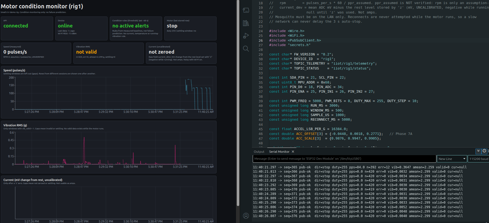
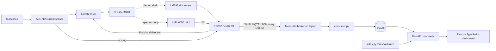

# Industrial IoT Predictive Maintenance System

A physical demonstration rig that monitors a small 6 V DC motor with an ESP32 and sensors, sends measurements over
Wi-Fi (MQTT) to a backend, stores them, flags a few unusual operating conditions with transparent threshold rules,
and shows everything in a web dashboard.



## Scope and honesty

This project is **motor condition monitoring and threshold-based anomaly flagging on a small demo rig**.
It is **not** validated for predicting real industrial failures. That would need labelled failure data and a proper
evaluation, and this rig has neither. The rules are simple thresholds chosen from the rig's own stored data; no
machine learning is used because the data does not support it. Several measurements are flagged as weak or invalid
(see [Limitations](#limitations)); the dashboard and API label them instead of hiding them.

## What works today

| Capability | State | Notes |
|---|---|---|
| ESP32 firmware: motor control, sensing, Wi-Fi + MQTT telemetry every 500 ms | Works | `firmware/phase8d_telemetry` v0.2; 3 s motor auto-stop |
| Motor speed (LM393 slot sensor + disc on the shaft) | Works as **pulses per second** | About 200-212 pulses/s at duty 195. Pulses per revolution never verified, so RPM is an assumption (2 per rev) |
| IMU vibration (RMS) | Works **only with the motor off** | About 0.005 g RMS on a rigid mount. Invalid while the motor runs (I2C errors) |
| Motor current (ACS712 20 A) | **Not usable** in the full system | Phase 5 (Wi-Fi off): about 0.1-0.2 A, uncalibrated. With Wi-Fi on the reading is too noisy |
| Temperature (DS18B20) | **Not available** | Sensor worked in Phase 3, then broke; omitted from telemetry |
| Broker, storage, API | Works | Mosquitto (LAN, password) -> SQLite -> read-only FastAPI |
| Dashboard | Works | React + TypeScript + Recharts; live test passed 2026-10-24 |
| Condition rules | Works, **limited** | 4 threshold rules, replayed on stored data, live check with the motor stopped |

## Architecture



Details, pin table, topics and payload fields: [`docs/architecture.md`](docs/architecture.md).

## Phase status

| Phase | Goal | Status |
|---|---|---|
| 0 | Identify hardware | Mostly done; battery voltage and adapter polarity never measured (no multimeter) |
| 1 | ESP32 setup and upload test | Done (2026-10-10) |
| 2 | MPU6050 over I2C | Done (2026-10-10) |
| 3 | DS18B20 temperature | Done (2026-10-10); sensor broke later |
| 4 | Drive the motor with the L298N | Done (2026-10-11) |
| 5 | ACS712 current sensing | Done (2026-10-15), **uncalibrated** |
| 6 | LM393 speed sensor | Closed with limits (2026-10-18): pulses/s valid, RPM unverified |
| 7 | IMU calibration and baselines | Closed partly (2026-10-18): calibration and motor-off baseline only |
| 8 | MQTT telemetry, SQLite, API | Done (2026-10-19) |
| 9 | React/TypeScript dashboard | Done (2026-10-20); live test passed 2026-10-24 |
| 10 | Threshold rules and portfolio documentation | Done (2026-10-25) |

Each phase has a write-up in [`docs/phases/`](docs/phases/) and a dated entry in
[`docs/engineering-log.md`](docs/engineering-log.md), including the corrections made along the way.

## Condition rules (Phase 10)

Four rules in [`backend/rules.py`](backend/rules.py), exposed at `/api/anomalies` and on the dashboard:

| Rule | Fires when |
|---|---|
| `DATA_STALE` | no telemetry for more than 5 s, or device status "offline" |
| `NO_SPEED_WHILE_COMMANDED` | motor commanded to run (duty 195) but under 50 pulses/s for 2 windows |
| `SPEED_WHILE_STOPPED` | motor stopped (after coast-down) but over 20 pulses/s for 2 windows |
| `VIBRATION_AT_REST` | motor stopped, valid IMU window, over 0.02 g for 3 valid windows |

Thresholds come from the stored data; replaying the rules over it shows where they fire, not how well they detect
faults. There are no rules for current, temperature, or vibration under load because no valid data exists for them.
See [`docs/phases/phase10_anomaly_rules.md`](docs/phases/phase10_anomaly_rules.md).

## Hardware

ESP32 DevKit V1 (USB-C), L298N motor driver, 6 V DC motor ("310DC"), ACS712 20 A current module, MPU6050-class IMU
(GY-521), DS18B20 (broken), LM393 slot sensor with a cardboard target disc, 6xAA battery holder. Verification status of
every part: [`docs/hardware-inventory.md`](docs/hardware-inventory.md).

## Run it

Prerequisites: Arduino IDE 2.x with the ESP32 board package and the PubSubClient library; Python 3.12; Node.js and npm;
Mosquitto on the laptop.

1. **Broker (once).** `sudo apt install mosquitto mosquitto-clients`, create the user with
   `sudo mosquitto_passwd -c /etc/mosquitto/passwd rig1`, and add `/etc/mosquitto/conf.d/lan.conf` containing
   `listener 1883`, `allow_anonymous false`, `password_file /etc/mosquitto/passwd`. Restart the service.
   The broker is plain MQTT: use it only on a trusted home network and never forward port 1883.
2. **Firmware.** In `firmware/phase8d_telemetry/`, copy `secrets.h.example` to `secrets.h` (git-ignored), fill in Wi-Fi
   and MQTT details (MQTT host = the laptop's LAN IP), select "ESP32 Dev Module", upload, and check the Serial Monitor
   (115200 baud) shows the telemetry banner. Commands: `f r s + - z i w<us> p<n>`; `z` zeroes the current reading
   with the motor stopped.
3. **Backend** (from the repo root):
   ```
   python3 -m venv backend/.venv
   source backend/.venv/bin/activate
   pip install -r backend/requirements.txt
   export MQTT_PASS='the real broker password'
   python3 backend/consumer.py            # terminal 1
   ```
   In a second terminal: `source backend/.venv/bin/activate`, `cd backend`,
   `uvicorn api:app --host 127.0.0.1 --port 8000`. The API has no authentication: keep it on 127.0.0.1.
4. **Dashboard** (third terminal): `cd frontend`, `npm install`, `npm run dev`, open http://localhost:5173.
5. **Checks.** Unit tests: `cd backend && python3 -m unittest discover -s tests`. Replay the rules over the database:
   `cd backend && python3 replay_rules.py`.

## Limitations

The main ones (full list and what would fix each: [`docs/limitations.md`](docs/limitations.md)):

- No labelled failure data: this is condition monitoring, not failure prediction.
- Pulses per revolution of the target disc was never verified: RPM is an assumption (2 per rev).
- Vibration under motor load is invalid (I2C errors while the motor runs; cause not proven).
- Current is uncalibrated (no reference meter) and too noisy with Wi-Fi on.
- The temperature sensor is broken.
- The battery pack voltage was never measured (no multimeter); six fresh AA cells (about 9 V nominal) drive a 6 V motor.
- Thresholds are tuned on a small amount of data from this one rig, mount and duty (195).
- The 6 V motor is a demonstration device, not industrial equipment.

## Repository layout

```
README.md
backend/      consumer.py (MQTT -> SQLite), api.py (read-only FastAPI), rules.py (threshold rules),
              replay_rules.py, tests/, backfill.sql, requirements.txt
frontend/     Vite + React + TypeScript dashboard
firmware/     one folder per sketch (folder name = .ino name); phase8d_telemetry is the current firmware
tools/        logtool.py: serial logger/analyzer for raw captures
docs/         architecture.md, limitations.md, engineering-log.md, hardware-inventory.md, safety-notes.md,
              phases/ (one write-up per phase), logs/ (raw captures), images/
```

## Safety

Read [`docs/safety-notes.md`](docs/safety-notes.md) before wiring anything. Test one subsystem at a time, disconnect
power before changing wiring, keep hands and hair away from the spinning disc, and keep motor runs short (the firmware
stops the motor after 3 s).

## License

Not yet chosen. Until a license file is added, all rights are reserved by default.
