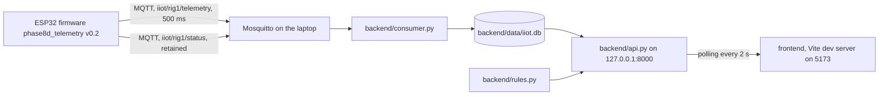

# Architecture

Small 6 V demo rig. Everything below describes what is built and running; "unverified" marks values that were never
validated against a reference.

## Data flow

## Hardware connections

| Function | ESP32 pin | Notes |
|---|---|---|
| I2C SDA / SCL (IMU) | GPIO 21 / 22 | IMU on 3V3 only |
| 1-Wire DQ (DS18B20) | GPIO 4 | 10 kOhm pull-up; sensor now broken, not used in telemetry |
| L298N ENA (PWM) / IN1 / IN2 | GPIO 25 / 26 / 27 | PWM 5 kHz, 8 bit. Outputs driven LOW in `setup()` |
| L298N logic 5 V | VIN -> L298N +5V terminal | The L298N 5V-enable cap stays removed |
| Common ground | GND -> L298N GND | |
| ACS712 OUT | GPIO 34 (ADC1, input-only) via 10 kOhm series resistor | ACS712 VCC from VIN (5 V), GND common |
| LM393 D0 | GPIO 18 (input with pull-up, CHANGE interrupt) | Module on 3V3 only |
| Onboard LED | GPIO 2 | |

Motor supply: 6xAA pack -> ACS712 screw terminals (in series) -> L298N +12V terminal. The ESP32 is powered over USB.
The ACS712 position is the Phase 5B arrangement; whether it is still in the path was not re-confirmed. Pack voltage was never measured.

## MQTT topics

| Topic | Content | Retained |
|---|---|---|
| `iiot/rig1/telemetry` | JSON, one message per 500 ms window | No |
| `iiot/rig1/status` | `online` / `offline`; `offline` is the MQTT Last Will | Yes |

## Telemetry payload (firmware v0.2)

| Field | Meaning | Trust |
|---|---|---|
| device_id, fw, seq, uptime_ms | identity; `seq` restarts at 0 at each boot | ok |
| run | counter of commanded runs since boot | ok |
| motor_dir, duty | commanded state (`fwd` / `rev` / `stop`, PWM duty 0-255) | ok |
| settling | true in the first window of a run (acceleration) | use to exclude |
| pulses_per_s | completed LM393 pulses per second | valid |
| rpm, ppr_assumed | `pulses_per_s * 60 / ppr_assumed`; ppr_assumed = 2 | **assumption, unverified** |
| current_dmv | mV change from the rest level set with `z`; null until set | **uncalibrated, noisy with Wi-Fi** |
| vib_rms_g, vib_n, vib_err, amean_g | IMU vibration RMS after removing the mean, samples used, I2C errors, mean magnitude | see `vib_valid` |
| vib_valid | IMU on, not settling, vib_n >= 400, vib_err = 0, 0.97 <= amean_g <= 1.03 | the quality gate |
| rssi | Wi-Fi signal (dBm) | ok |

No temperature field (DS18B20 broken). The ESP32 has no clock: `received_at` is the laptop's UTC time.

## Storage

SQLite file `backend/data/iiot.db` (git-ignored). Table `messages` keeps every MQTT message raw; table `telemetry`
holds the typed telemetry rows (columns as in the payload, plus `id` and `received_at`).

## API (read-only, 127.0.0.1:8000, no authentication)

| Endpoint | Returns |
|---|---|
| `/api/health` | `{ok: true}` |
| `/api/status` | latest device status and its time |
| `/api/latest` | last stored telemetry row (may be old) and data caveats |
| `/api/telemetry?limit&after_id` | the newest `limit` rows with id > after_id, oldest first (limit 1-5000) |
| `/api/anomalies?windows` | active condition-rule alerts for the newest `windows` rows (default 120, about 60 s), plus stale check |

## Dashboard

React + TypeScript + Vite + Recharts. Cards: API, Device (with staleness), Condition rules, Motor, Speed, Vibration
(only when `vib_valid` = 1), Current (uncalibrated). Three charts (speed, valid vibration, current) keep the newest 600
rows and leave out settling windows. CORS allows only http://localhost:5173.

## Safety-relevant design choices

- The motor auto-stops after 3 s in firmware, independent of the network.
- Wi-Fi/MQTT reconnects are never attempted while the motor runs, so a slow network cannot delay the stop.
- Mosquitto requires a password; the API listens on 127.0.0.1 only. MQTT is unencrypted: trusted LAN only.
