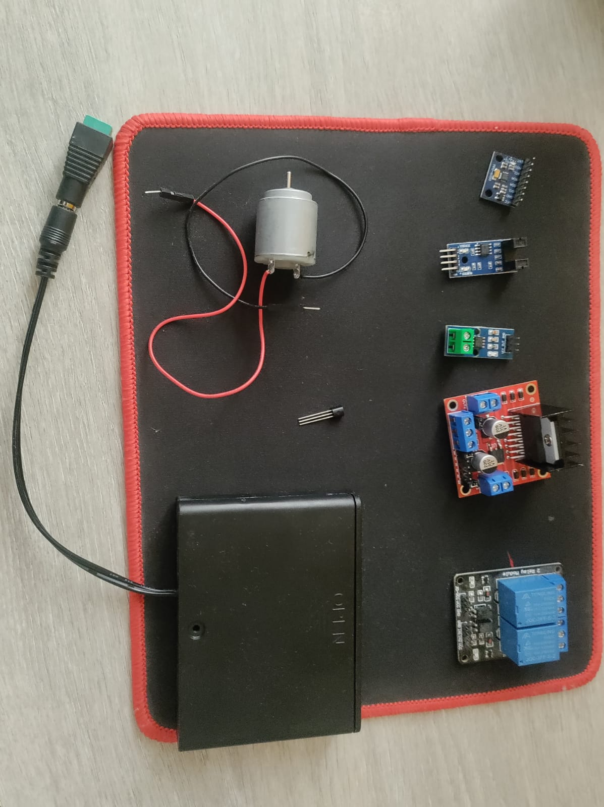
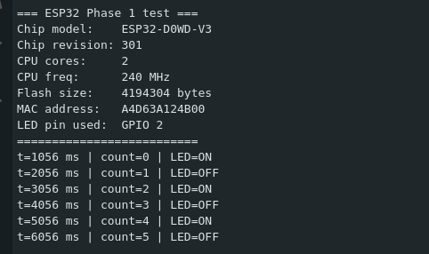

# Engineering Log

Entry format: date, phase, wiring, firmware version, readings, result,
issues, next step. Only record what was actually observed.

---

## 2026-10-10 - Phase 0: hardware identification (in progress)

- Photographed the ESP32 (front/back) and the parts layout.
- ESP32 back silkscreen: "ESP32 DEVKIT V1 TYPEC"; 30-pin header layout
  appears from the photo. Front labels read: left EN, VP, VN, D34, D35,
  D32, D33, D25, D26, D27, D14, D12, D13, GND, VIN; right D23, D22, TX0,
  RX0, D21, D19, D18, D5, TX2, RX2, D4, D2, D15, GND, 3V3.
-    - it’s verified now: ACS712 variant, LM393 sensor type, DS18B20
     marking/pinout, L298N jumper/regulator layout, battery pack voltage,
     barrel adapter polarity. MPU6050 labels/solder joints not inspected
     visually; verified electrically in Phase 2.
- A 2-channel relay module is also in the parts pile; not part of this
  project and stays unconnected.
- Skipped: MPU6050 close-up photos. Sensor verified electrically in Phase 2 instead.

## 2026-10-10 - Phase 1: ESP32 setup (DONE)

- Board: ESP32 DevKit V1 (USB-C)
- Chip: ESP32-D0WD-V3, revision 301, 2 cores, 240 MHz, 4 MB flash
- Toolchain: Arduino IDE on Ubuntu, board "ESP32 Dev Module", 115200 baud
- Firmware: `firmware/phase1_esp32_test` v0.1
- Wiring: USB only
- Result: chip info printed; counter and LED state toggle every 1000 ms
  (observed up to t = 165056 ms, count = 164)
- Open: `lsusb` output (USB-serial chip), visual confirmation of LED blink

## 2026-10-10 - Phase 2: IMU over I2C (DONE)
- Wiring: VCC->3V3, GND->GND, SDA->GPIO21, SCL->GPIO22 (USB power only)
- Firmware: phase2_i2c_scan v0.1, phase2_mpu6050_read v0.2
- WHO_AM_I = 0x70 (MPU-6500 class, sold as MPU6050), address 0x68
- Flat az ~ +1.258 g; upside down az ~ -0.763 g; tilt (~45 deg about Y):
  ax ~ -0.787 g, az ~ +0.920 g
- Estimated Z offset ~ +0.25 g, X offset ~ -0.13 g (assumes level table)
- Raw |a| ranges 0.78-1.27 g across orientations: per-axis calibration
  needed before baselines (Phase 7)
- Gyro bias ~ +1.1 / +1.7 / -0.4 deg/s; rotation test PASS
- Details: docs/phases/phase2_imu.md; raw captures: docs/logs/phase2_*.txt
- Next: Phase 3, DS18B20
